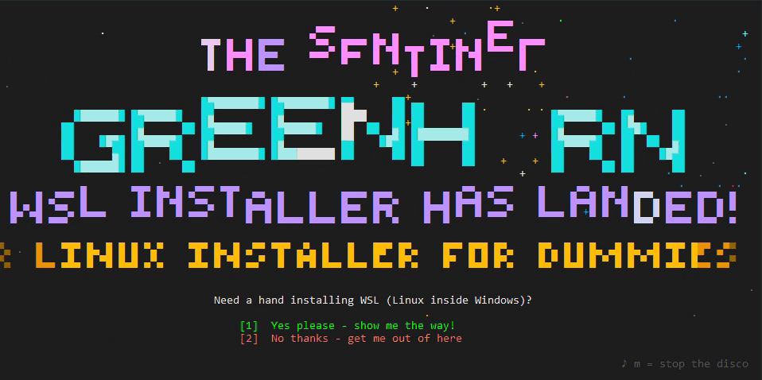

# Sentinel Greenhorn

*A small batch file, with an enormous inside!*

<p align="center"></p>

**The WSL installer for dummies. With fireworks. And a chiptune. Obviously.**

Installing WSL (Windows Subsystem for Linux) should not need a computer science degree.
Sentinel Greenhorn is a single `.bat` file you double-click. It throws a fireworks show,
plays a retro synth tune, and then walks you through the whole thing, one friendly step at a
time, cheering you on when it works and calmly fixing it with you when it doesn't.

## How to use it

1. Download **`Sentinel-Greenhorn.bat`** from the [latest release](../../releases/latest).
2. Double-click it.
3. Windows may say *"Windows protected your PC"* because the file came from the internet.
   Click **More info → Run anyway**.
4. Enjoy the show, press **1**, and say **Yes** when Windows asks for administrator rights.

That's it. Mr. Greenhorn takes it from there, including restarts: if the PC has to reboot
(or visit the BIOS), the installer pops up again on its own after you log in and carries on
where it left off.

**Want a sneak peek first?** Run it with `--dry-run` from a terminal. It shows everything it
*would* do and changes nothing:

```powershell
.\Sentinel-Greenhorn.bat --dry-run
```

| Flag | What it does |
|---|---|
| `--dry-run` | Show everything, change nothing |
| `--fresh` | (with `--dry-run`) pretend WSL isn't installed, to see the whole install path |
| `--oops` | (with `--dry-run`) pretend something fails, to see how errors are handled |
| `--novirt` | (with `--dry-run`) pretend virtualization is off in the BIOS |
| `--resume` | (with `--dry-run`) preview the "welcome back after a restart" screen |
| `--go` | Skip the fireworks and go straight to the guide |
| `--quiet` | No music (or press **M** on the title screen) |

## What it does, step by step

1. **Says hello to your PC**: checks the Windows version, free disk space, memory and that
   virtualization is on. If it's off in the BIOS, it finds out who made your PC, tells you
   exactly which menu to look in, and restarts straight into the BIOS for you.
2. **Installs the WSL engine**, with a plan B (DISM) if the normal way fails.
3. **Installs Linux** (Ubuntu), and explains the username/password prompt in plain words.
4. **Fixed IP address**: sniffs out your router and home network, picks a private network
   for WSL that doesn't clash with anything (LAN, VPN, Hyper-V), checks the addresses are
   free, and gives Linux an IP that never changes. Or mirrored networking, if you prefer.
5. **Speed and memory**: writes a sensible `.wslconfig` (memory limit, swap, memory reclaim,
   sparse disk).
6. **Sets up the fixed IP** on both sides, plus the name `wsl.local` in the Windows hosts file.
7. **Spring cleaning**: tidies up inside Linux and compacts the virtual disk so the space
   actually comes back to Windows.
8. **The big test**: checks that Linux runs, is WSL 2, has systemd and can reach the internet.
9. **Bonus: [Tortugarr](https://github.com/tortugarr/tortugarr)**: downloads the server
   installer and the TV/phone apps, checks the checksums, explains how to get the apps onto
   an Android TV and phone, and can even serve them over Wi-Fi with a short address.
10. **Done!** A finale with fireworks, a list of handy tricks, and the safety net is taken
    down again.

## What it changes on your PC

Being honest about it, so nothing comes as a surprise:

- Windows features: *Windows Subsystem for Linux* and *Virtual Machine Platform* (via `wsl --install`).
- `%USERPROFILE%\.wslconfig` (the old one is backed up as `.wslconfig.bak-<date>`).
- Fixed IP option: a line in `/etc/wsl.conf` inside Linux, a scheduled task
  `Greenhorn-WSL-FixedIP`, a helper script in `C:\ProgramData\GreenhornWSL\`, and a
  `wsl.local` line in the Windows hosts file (backed up as `hosts.bak-greenhorn`).
- During the run only: the safety net (scheduled task `Greenhorn-WSL-Resume`), removed again
  when the guide finishes. The temporary firewall rule for the APK shop is removed when you
  close the shop.
- A log in `%TEMP%\greenhorn-wsl-helper.log`.

### Undo the fixed IP setup

```powershell
Unregister-ScheduledTask -TaskName Greenhorn-WSL-FixedIP -Confirm:$false
Remove-Item C:\ProgramData\GreenhornWSL -Recurse
# then remove the line ending in "# greenhorn-wsl" from C:\Windows\System32\drivers\etc\hosts
```

Inside Linux, remove the two lines starting at `# greenhorn-fixed-ip` from `/etc/wsl.conf`.

## Requirements

- Windows 11 (Windows 10 2004 or newer works too)
- Virtualization support in the CPU (nearly every PC from the last ten years)
- An administrator account
- A sense of humour (optional, but recommended)

## Under the hood

One file, no downloads, no dependencies. The `.bat` is a tiny launcher that hands itself to
Windows PowerShell. The fireworks are drawn with ANSI colours and half-block characters, and
the music is a small chiptune synthesizer written in C# that renders the tune into memory
when the installer starts.
