<p align="center"></p>

<p align="center"><i>A small batch file, with an enormous inside!</i></p>

<p align="center">
  
  
  
  
  
</p>

<p align="center"><b>The WSL installer for dummies. With fireworks. And a chiptune. Obviously.</b></p>

Installing WSL (Windows Subsystem for Linux) should not need a computer science degree.
Sentinel Greenhorn is a single `.bat` file you double-click. It throws a fireworks show,
plays a retro synth tune, and then walks you through the whole thing, one friendly step at a
time, cheering you on when it works and calmly fixing it with you when it doesn't.

<h2 align="center"></h2>

<p align="center">
  <a href="https://github.com/sentinelarmory/greenhorn/releases/latest/download/Sentinel-Greenhorn.bat"></a>
</p>

1. Download **`Sentinel-Greenhorn.bat`** (the button above, or the [latest release](../../releases/latest)).
2. Double-click it.
3. Windows may say *"Windows protected your PC"* because the file came from the internet.
   Click **More info → Run anyway**.
4. Enjoy the show, press **1**, and say **Yes** when Windows asks for administrator rights.

That's it. Mr. Greenhorn takes it from there, restarts included: if the PC has to reboot (or
visit the BIOS), the installer pops up again by itself after you log in and carries on where
it left off.

> **Want a sneak peek first?** Run it with `--dry-run`. It shows everything it *would* do and
> changes nothing: `.\Sentinel-Greenhorn.bat --dry-run`

<h2 align="center"></h2>

<p align="center"></p>

<details>
<summary><b>The ten steps in detail</b></summary>

1. **Saying hello to your PC**: checks the Windows version, free disk space, memory and that
   virtualization is on. If it's off in the BIOS, it finds out who made your PC and tells you
   exactly which menu to look in. On UEFI PCs (nearly every Windows 11 PC) it restarts
   straight into the BIOS for you; on older PCs it restarts and tells you which key to press.
   If virtualization is on but the Windows hypervisor has been switched off (some games do
   that), it switches it back on.
2. **The WSL engine**: switches on the right Windows features with `wsl --install`, with a
   plan B (DISM) if the normal way fails.
3. **Picking a Linux**: updates WSL, makes WSL 2 the default, and installs Ubuntu (or
   Ubuntu 24.04), explaining the username and password prompt in plain words. Already have a
   distro? Then it uses that one.
4. **Fixed IP address**: sniffs out your router and home network, picks a private network for
   WSL that clashes with nothing (LAN, VPN, Hyper-V), checks the addresses are free, and gives
   Linux an IP that never changes. Or mirrored networking, if you prefer.
5. **Speed and memory**: writes a new `.wslconfig` (half of the PC's memory, 4 GB swap, memory
   reclaim, sparse disk) and makes the Linux disk sparse.
6. **Setting up the fixed IP** on both sides, plus the name `wsl.local` in the Windows hosts file.
7. **Spring cleaning the disk** (it asks first): tidies up inside every Linux distro and compacts
   the virtual disks, so the space actually comes back to Windows.
8. **Does Linux work? (the big test)**: Linux answers, runs WSL 2, has systemd, and can look
   up addresses on the internet (a DNS check).
9. **Next stop: [Tortugarr](https://github.com/tortugarr/tortugarr)**: downloads the server
   installer and the phone app (and the TV app if you have an Android TV) into
   `Downloads\Tortugarr`, checks the checksums, explains how to get the apps onto the TV and
   phone, and can even serve them over Wi-Fi with a short address. It doesn't install the
   server: it shows the commands to run and puts them on the clipboard.
10. **Done! Hooray!** A fireworks finale, a list of handy tricks, and the safety net is taken
    down again.

</details>

<h2 align="center"></h2>

<p align="center"></p>

Nobody panics. Every error comes with a plain-words explanation and the exact thing to do
next. Restarts and trips to the BIOS are covered by a safety net: a one-shot logon task brings
the installer back after you log in, and is taken down again when everything is done (or when
you choose to stop).

Found a bug, or did something go wrong that the installer couldn't fix? Take a screenshot and
[open an issue](../../issues).

<h2 align="center"></h2>

| Flag | What it does |
|---|---|
| `--dry-run` | Show everything, change nothing |
| `--fresh` | (with `--dry-run`) pretend WSL isn't installed, to see the whole install path |
| `--oops` | (with `--dry-run`) pretend something fails, to see how errors are handled |
| `--novirt` | (with `--dry-run`) pretend virtualization is off in the BIOS |
| `--resume` | (with `--dry-run`) preview the "welcome back after a restart" screen |
| `--go` | Skip the fireworks and go straight to the guide |
| `--quiet` | No music (or press **M** on the title screen) |

<h2 align="center"></h2>

Being honest about it, so nothing comes as a surprise. It asks before restarting the PC and
before the disk clean-up.

- **Windows:** switches on *Windows Subsystem for Linux* and *Virtual Machine Platform*
  (`wsl --install`), runs `wsl --update` and `wsl --set-default-version 2`, and shuts WSL
  down (`wsl --shutdown`) a few times along the way. If the Windows hypervisor is switched off,
  it switches it on (`bcdedit /set hypervisorlaunchtype auto`).
- **`%USERPROFILE%\.wslconfig`** is replaced with a new one, not merged. The old one is backed
  up as `.wslconfig.bak-<date>` first.
- **Sparse disk:** `wsl --manage <distro> --set-sparse true`, and if WSL refuses, once more
  with `--allow-unsafe`.
- **Fixed IP option:** two lines in `/etc/wsl.conf` inside Linux (backed up as
  `/etc/wsl.conf.bak-greenhorn`), a scheduled task `Greenhorn-WSL-FixedIP` that runs at logon
  and every 5 minutes, a helper script in `C:\ProgramData\GreenhornWSL\`, and a `wsl.local` line
  in the Windows hosts file (backed up as `hosts.bak-greenhorn`).
- **Disk clean-up, in every Linux distro except `docker-desktop`:** clears the apt cache and
  package lists, trims the systemd journal to 50 MB, and **deletes everything in `/tmp` and
  `/var/tmp`**. Then it compacts each virtual disk (`Optimize-VHD`, or `diskpart` on Windows Home).
- **Tortugarr step:** downloads into `%USERPROFILE%\Downloads\Tortugarr` and puts the server
  install commands on the clipboard.
- **During the run only:** the safety net (scheduled task `Greenhorn-WSL-Resume`, plus
  `resume.json` and `resume.ps1`), removed again when the guide finishes or you stop, and a
  temporary firewall rule for the APK shop, removed when you close the shop.
- **Left behind on purpose:** a copy of the installer in `C:\ProgramData\GreenhornWSL\`, so it can
  be run again later, and a log in `%TEMP%\greenhorn-wsl-helper.log`.
- **Talks to the internet:** Microsoft (WSL and Ubuntu downloads) and GitHub (the latest
  Tortugarr release and its files). No telemetry.

<details>
<summary><b>Undo the fixed IP setup</b></summary>

```powershell
Unregister-ScheduledTask -TaskName Greenhorn-WSL-FixedIP -Confirm:$false
Remove-Item C:\ProgramData\GreenhornWSL -Recurse
# then remove the line ending in "# greenhorn-wsl" from C:\Windows\System32\drivers\etc\hosts
```

Inside Linux, remove the two lines starting at `# greenhorn-fixed-ip` from `/etc/wsl.conf`.

</details>

**Requirements:** Windows 11 (or Windows 10 2004 and newer), a CPU with virtualization support
(nearly every PC from the last ten years), an administrator account, and a sense of humour
(optional, but recommended).

<h2 align="center"></h2>

One file, nothing to install first, no telemetry. The `.bat` is a tiny launcher that hands
itself to the Windows PowerShell that comes with Windows. The fireworks are drawn with ANSI colours and half-block
characters, and the music is a small chiptune synthesizer written in C# that renders the tune
into memory when the installer starts. The animated images on this page are generated by
[`tools/readme_svgs.py`](tools/readme_svgs.py), and [`docs/index.html`](docs/index.html) is the
full show as a web page, the same animation ported to JavaScript.

<p align="center"></p>

<p align="center"><b>Sentinel has got your back.</b></p>
